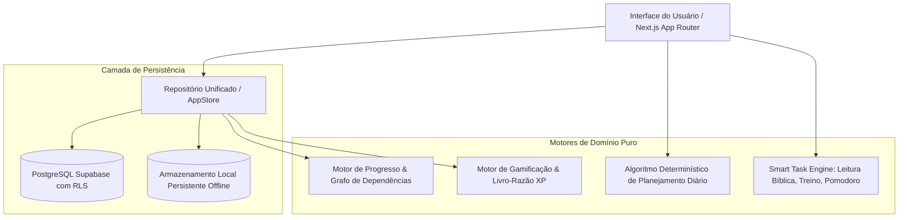

# Arquitetura do Sistema — Project Ascend

## 1. Visão Geral
O **Project Ascend** é um SaaS de evolução pessoal e planejamento diário concebido como um monólito modular de alta coesão, implementado em **Next.js 15 (App Router)** com **TypeScript em modo estrito**.

A premissa fundamental do sistema é **Zero Inteligência Artificial**: nenhuma chamada a modelos LLM, agentes sintéticos ou APIs não determinísticas é utilizada. Toda a inteligência da plataforma provém de regras de negócio matemáticas, ordenação topológica de grafos, livros-razão idempotentes e algoritmos determinísticos de priorização.

---

## 2. Diagrama de Módulos

---

## 3. Detalhamento dos Motores

### 3.1 Motor de Progresso e Grafo de Dependências (`src/lib/domain/progress.ts`)
- **Detecção de Ciclos**: Implementado através do algoritmo de busca em profundidade (DFS) com rastreamento de pilha de recursão (`recStack`), prevenindo que o usuário crie dependências circulares (ex.: A depende de B e B depende de A).
- **Cálculo de Bloqueio**: Avalia se qualquer dependência requerida não atingiu o status `completed`. Tarefas bloqueadas são sinalizadas na interface e recebem penalização no score do planner.
- **Progresso Ponderado**: Calcula a proporção ponderada de conclusões de tarefas e submissões, gerando uma taxa inteira de 0% a 100% reproduzível.

### 3.2 Motor de Gamificação & XP Ledger (`src/lib/domain/gamification.ts`)
- **Cálculo de Recompensa**: Fórmula baseada na matriz de Dificuldade (`easy: 25`, `medium: 50`, `hard: 100`, `epic: 250`), multiplicada pela Prioridade (`low: 1.0`, `medium: 1.1`, `high: 1.25`, `urgent: 1.4`) somada a um bônus por tempo estimado de foco (1 XP a cada 10 minutos, limitado a 30 XP).
- **Curva de Nível Exponencial**:
  $$\text{XP}_{\text{necessário}}(L) = \lfloor 100 \times L^{1.6} \rfloor$$
- **Livro-Razão Idempotente (`xp_ledger`)**: Cada concessão gera uma chave única (ex.: `task:{id}:complete`). Caso uma requisição seja reenviada, nenhuma duplicidade de XP é concedida. Na hipótese de reabertura da tarefa, é gerado um evento de estorno com chave `task:{id}:revert` recalculando o saldo do personagem.
- **Distribuição de Atributos**:
  - `bible_reading`, `reading`, `study` $\rightarrow$ **Conhecimento**
  - `workout` $\rightarrow$ **Saúde**
  - `habit`, `meditation` $\rightarrow$ **Consistência**
  - `timed`, `numeric_goal` $\rightarrow$ **Disciplina**
  - `simple`, `checklist`, `evidence` $\rightarrow$ **Execução**

### 3.3 Algoritmo de Planejamento Diário (`src/lib/domain/planner.ts`)
- Calcula a pontuação determinística de prioridade com base em pesos transparentes:
  - Prioridade Urgente (+400), Alta (+300), Média (+200), Baixa (+100)
  - Prazos: Atrasada (+350), Vence Hoje (+200), Futuro (+50)
  - Tarefa Bloqueada por Dependência (-1000)
- Divide as tarefas em dois grupos com base no orçamento de tempo informado pelo usuário (Time Budget Slider):
  1. **Tarefas que cabem no horário planejado**.
  2. **Tarefas excedentes** (sugeridas para reagendamento).

### 3.4 Smart Task Engine (`src/lib/bible/`, `src/lib/smart-tasks/`)
- Módulo Bíblico com escrituras canônicas completas em português sob domínio público (Almeida Revista e Corrigida) incorporadas para funcionamento offline imediato, seleção de livros/capítulos e campo de reflexão pessoal persistente.
- Módulos de Treino com registro de séries, repetições e peso em kg.
- Módulo de Estudo com cronômetro Pomodoro de 25 minutos e controle de foco.
